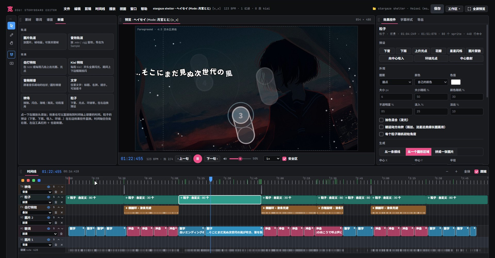

# 宽 Kuan Storyboard

宽是一个 osu! 歌词 storyboard 编辑器，给不想手写 .osb 的人用：像 Premiere 一样在时间轴上摆歌词、图片、粒子和特效，改了马上就能在预览里看到，最后导出 osu! 能直接读的 storyboard。

Kuan is an osu! lyric storyboard editor with a Premiere-style timeline: drop in your lyrics, images and effects, see the result instantly, and export a storyboard osu! can read.

[下载最新版 / Download the latest version](../../releases/latest)，或者直接用浏览器打开 `Kuan.html`。

